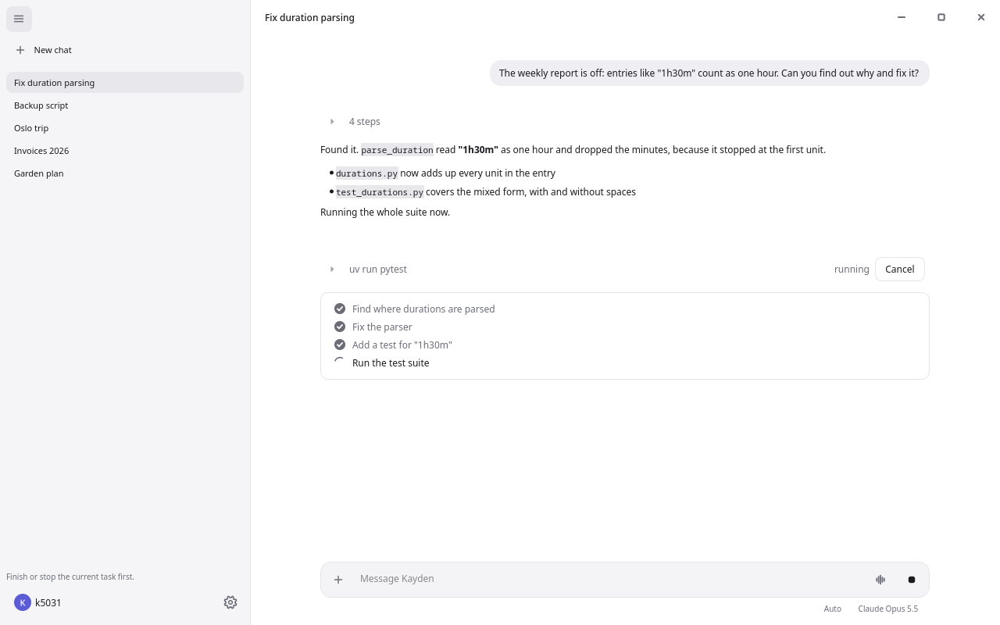

# Kayden

An AI agent for your computer, in a terminal or a desktop app. It runs commands, works with
files and searches the web, decides on its own only what is safe and asks you about the
rest, and stops at hard spending limits. Works with Anthropic, DeepSeek and
OpenAI-compatible models.

<picture>
  <source media="(prefers-color-scheme: dark)" srcset="docs/images/main-dark.png">
  
</picture>

The [desktop app](docs/desktop-app.md): Kayden plans the task as a checklist, works through
it step by step and reports what it found.

A runtime drives four swappable modules (Core, Memory, Tools, Frontend); see
`src/kayden/api.py` and `SPEC.md`.

## Quick start

Requires Linux, Python 3.12+ and [uv](https://docs.astral.sh/uv/).

```bash
git clone https://github.com/K5031/Kayden.git
uv tool install --editable Kayden
export ANTHROPIC_API_KEY=sk-ant-...   # or enter a key in the settings screen (F2)
mkdir ~/kayden-work && cd ~/kayden-work
kayden
```

Kayden works freely in the folder you start it from; anything outside it gets a quick
automatic check, and Kayden asks you when it is unsure. Start it in a folder made for it;
your home folder is too broad to count.

## Documentation

The [documentation](docs/README.md) covers getting started, using Kayden, settings, the
concepts behind it and development.

## Status

Early MVP, version 0.0.0. No release has been made and the API may still change.

## Contributing

See [CONTRIBUTING.md](CONTRIBUTING.md).

## License

MIT; see `LICENSE`.
