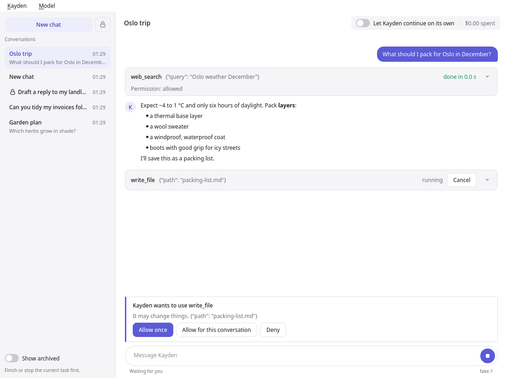
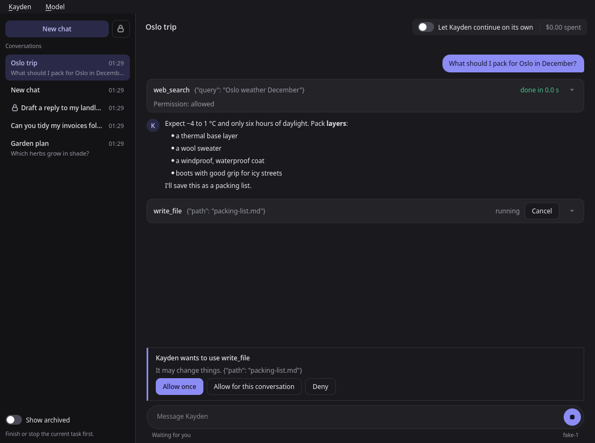

# Desktop app

The desktop app is a window for Kayden: a conversation list on the left, the conversation
in the middle, and a message box at the bottom. It does what the terminal app does, without
a terminal.



It follows your computer's light or dark setting, and switches when you change it.



## Install

Ready-made downloads (a `.dmg` for macOS, a Flatpak and an AppImage for Linux) are not
published yet. Until then, install Kayden with its `desktop` extra from a checkout (see
[Getting started](getting-started.md) for cloning):

```bash
uv tool install --python 3.13 --editable "Kayden[desktop]"
```

Then run `kayden` and choose the desktop app as the interface in Settings. From then on,
`kayden` opens the desktop app, and you can switch back to the terminal app in its
Settings. To run it without installing, use this in place of `kayden`:

```bash
cd Kayden
uv run --python 3.13 --extra desktop kayden
```

On Linux, choose **Kayden → Add to App Menu** once the app is open. Kayden then appears in
your app menu with its own icon and starts without a terminal. The menu item is there only
while the app menu has no entry for this install.

The app is tested on Python 3.13. The Qt libraries it uses are not fully compatible with
Python 3.15 yet. Without the `desktop` extra, the desktop app is not offered in Settings.

## First start

When no API key is saved, a welcome window asks for three things:

1. **Your AI provider**: Claude, DeepSeek or OpenAI. **Get a key** opens the provider's
   website.
2. **Your API key.** Kayden keeps it in your computer's keychain. If your computer has no
   keychain, set the environment variable named in the message instead
   (`ANTHROPIC_API_KEY`, `DEEPSEEK_API_KEY` or `OPENAI_API_KEY`).
3. **A work folder and a spending limit.** The work folder is where Kayden runs commands
   and reads and writes files; it is `~/Kayden` unless you choose another. The spending
   limit is optional.

Kayden then restarts with your provider. If the provider refuses the key, the message says
so; enter another one in Settings and choose **Restart now**. If Kayden cannot start for
another reason, the Settings window opens with the message.

## Using it

| To | Do this |
|---|---|
| Send a message | Type it and press **Enter**. **Shift+Enter** starts a new line. |
| Stop Kayden | Press the round button in the message box (it shows a square while Kayden works) or **Esc**. |
| Answer a permission request | Choose **Allow once**, **Allow for this conversation** or **Deny** on the card above the message box. |
| Cancel one task | Press **Cancel** on its card. |
| See what a tool did | Each step reads as a short sentence the agent writes ("Search the web for flights to Oslo"). Point at it to see the tool and its exact input; press the arrow for the result. A step without a sentence shows the tool and its input. |
| See the model's reasoning | Open **Thinking** above a reply. |
| Start over | **New chat** (**Ctrl+N**). |
| Work in another folder | Click the folder above the conversation and choose one. A chat with no messages yet moves there; otherwise a new chat starts in it. See [Folders](using-kayden.md#folders). |
| Go back to a conversation | Click it in the list. |
| Rename, archive or delete one | Right-click it (or select it and press the Menu key): **Rename…** (**F2**), **Archive**, **Delete…** (**Delete**). Turn on **Show archived** under the list to see hidden ones. |
| Pick up where one left off | Right-click it: **Continue in a new conversation**. |
| See what Kayden remembers | **Kayden → Memory…**: add, edit or forget what it keeps across conversations. |
| Change the model | The **Model** menu. |
| Change settings | **Kayden → Settings** (**Ctrl+,**). |

Each conversation in the list shows its name, when it was last used, and the start of its
first message. Until Kayden names a conversation, the start of its first message is its
name; a conversation with no messages yet is called "New chat".

Messages you send while Kayden works are queued and shown greyed until Kayden reads them.
You can switch conversations only while Kayden is not working on anything; renaming,
archiving and deleting work any time.

**Delete…** asks first: deleting erases the conversation and its summary, and cannot be
undone. What Kayden remembered from it stays in Memory, where you can forget it too. To only hide a conversation, choose **Archive**. Deleting the open
conversation opens a new chat in its place, once Kayden is not working. See [Deleting](concepts.md#deleting) for what
deletion does not reach.

Above the conversation are the conversation's folder and what Kayden has spent so far,
across all conversations. The
line under the message box shows what Kayden is doing, how many tasks run in the background
and the model.

At start the app reopens your most recent conversation, or the one you were in when you
switched from the terminal app.

## Settings

The Settings window has the same settings as the terminal app; see [Settings](settings.md).
Raising or removing the spending limit, or letting Kayden do more without asking, asks you
to confirm first. The provider, key and modules apply when Kayden restarts: **Restart now**
in the Settings window does that. **Folder for new chats** applies to the next new chat.

## Switching to the terminal app

Choose **Terminal (TUI)** as the interface in Settings and save. The app cannot open a
terminal itself: the terminal app is used the next time you run `kayden` in a terminal.
From the terminal app, choosing the desktop app and **Restart now** opens this app in the
same conversation.

## Good to know

- The app and the terminal app share the same data folder (`~/.kayden`). Only one of them
  can be open at a time; the other says Kayden is already open.
- Closing the window stops running tasks, as quitting the terminal app does.
